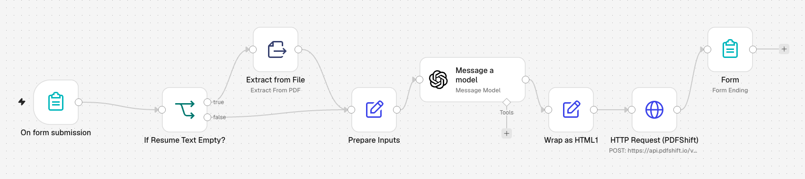

# AI Resume Customizer

A small web app built entirely in n8n: upload a resume, paste a job description,
download an ATS-friendly rewritten resume as a PDF.

## How it works

1. **n8n Form trigger** — fields: resume text *or* resume PDF, plus the job description.
2. **If resume text is empty** → extract text from the uploaded PDF; otherwise use the text.
3. **Prepare the prompt** — expert-resume-writer instructions: keep every real detail,
   rewrite bullets with the JD's keywords and responsibilities, no fabrication.
4. **OpenAI (GPT-4.1 mini)** rewrites the resume.
5. **Wrap as HTML** with print CSS → **PDFShift** renders a PDF.
6. **Form completion** returns the PDF as a download.

## Stack

n8n Forms · Extract From File (PDF) · OpenAI · PDFShift · HTML/CSS

## Placeholders to replace

Add your own OpenAI and PDFShift credentials after import.
