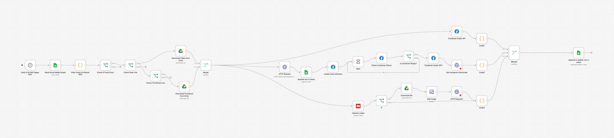

# Social Media Publisher (Facebook · Instagram Reels · YouTube)

Built for an agency client that manages several brand accounts. Content
managers fill one Google Sheet; the workflow publishes each video to all three
platforms at the scheduled time and writes the live links back to the sheet.

## The problem

Posting the same reel to Facebook, Instagram and YouTube by hand, for multiple
brands, at specific times, every day. Error-prone and a full-time job.

## How it works

1. **Schedule trigger** runs every minute and reads the schedule sheet.
2. **Filter (JavaScript)** keeps rows where `Post Action = Post`, `Progress ≠ Posted`,
   the row has content, and the `SCHEDULE TIME` matches the current IST hour:minute.
3. **Download media** from Google Drive — the reel, and the thumbnail if provided.
4. **Fan out to three platforms** from a Merge node:
   - **Facebook Page** — video upload via Graph API, then the post URL is built from the returned video ID.
   - **Instagram Reels** — upload to Cloudinary to get a public URL, create a media
     container, **poll container status in a Wait loop** until `FINISHED`, publish, then
     fetch the shortcode/permalink.
   - **YouTube** — upload the video; if a thumbnail exists, resize it and set it via the
     thumbnails API.
5. **Merge the three URLs** by position and append/update the sheet row with
   `facebook_url`, `instagram_url`, `youtube_url` and `Progress = Posted`.

## Things worth noting

- Instagram's publish API is asynchronous; the Wait → Check status → loop pattern
  avoids the "media not ready" failure most naive implementations hit.
- Timezone handling is explicit (IST) so a sheet written by people in India behaves
  as expected on a UTC server.
- The sheet is the single source of truth: no separate dashboard to maintain.

## Stack

n8n · Google Sheets · Google Drive · Meta Graph API v22 · YouTube Data API v3 · Cloudinary

## Placeholders to replace

`YOUR_SCHEDULE_SHEET_ID`, `YOUR_LOG_SHEET_ID`, `YOUR_IG_BUSINESS_ACCOUNT_ID`,
`YOUR_FB_PAGE_ID`, `YOUR_CLOUD_NAME`, `YOUR_UPLOAD_PRESET`.
