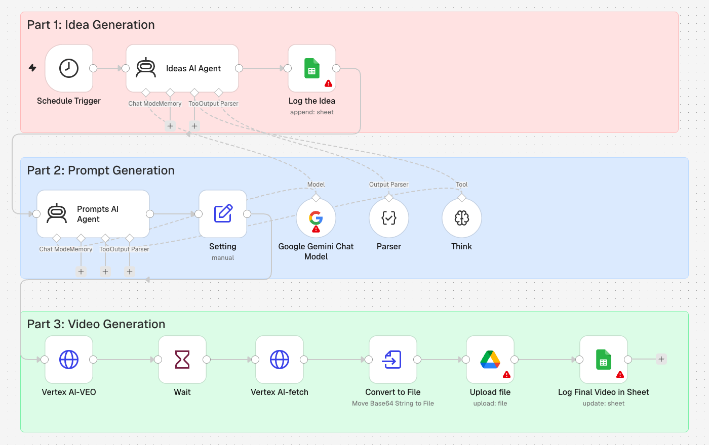

# AI Video Generator (Gemini agents + Veo 3)

A three-stage pipeline that turns a topic into a finished short video with no
human in the loop.

## How it works

**Part 1 — Idea generation.** A Gemini-backed AI Agent (with a Think tool and a
structured-output parser) produces one realistic video idea, caption and environment
description for the given topic, and logs it to Google Sheets.

**Part 2 — Prompt generation.** A second agent turns the idea into a cinematic,
selfie-style **Veo 3 prompt**, again with structured output.

**Part 3 — Video generation.** A Set node holds the Vertex AI config; an HTTP request
calls `predictLongRunning` on `veo-3.0-generate-preview`, a Wait node gives it time,
`fetchPredictOperation` retrieves the base64 video, it's converted to a file, uploaded
to Google Drive, and the sheet row is updated with the final link.

## Stack

n8n AI Agents · Google Gemini · Vertex AI (Veo 3) · Google Drive · Google Sheets

## Placeholders to replace

`YOUR_GCP_PROJECT_ID`, `YOUR_GCP_ACCESS_TOKEN` (use a proper Google credential rather
than a pasted token in production), `YOUR_SHEET_ID`.
