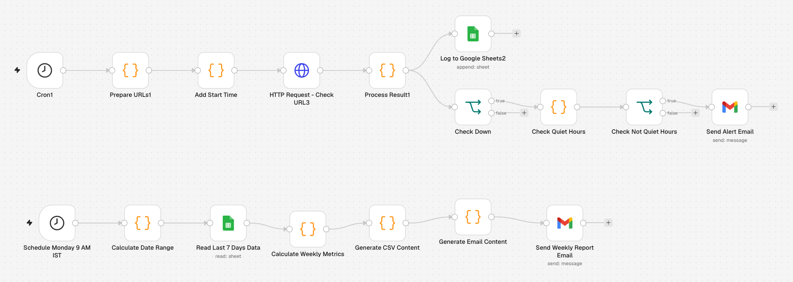

# Website Uptime Monitor + Weekly Report

Two flows in one workflow: a 15-minute health check with downtime alerts, and a
Monday-morning uptime report with a CSV attachment.

Built as a take-home technical assessment for a hiring process, then kept as a
reference implementation.

## Flow 1 — check every 15 minutes

1. A Code node lists the URLs to monitor (includes two deliberately invalid hosts
   to exercise the failure path).
2. Records a start timestamp, then an **HTTP Request** with browser user-agent,
   30 s timeout and up to 5 redirects, returning the full response.
3. A Code node normalises the result: `status` (Up/Down), `http_code`, `response_ms`,
   `error`, `final_url`, timestamps in UTC and IST.
4. Every check is **appended to a Google Sheet**.
5. If `status = Down`: check **quiet hours (23:00–07:00 IST)**; outside them, send a
   **Gmail alert** with the URL, code, error and response time.

## Flow 2 — weekly report, Monday 09:00 IST

1. Compute the last-7-days window.
2. Read the log sheet and **filter by UTC timestamp**.
3. Group by URL → uptime %, total checks, downtime incidents.
4. Build a CSV and an HTML email with a colour-coded table (🟢 ≥ 99 %, 🟡 ≥ 95 %, 🔴 below).
5. Send the report by Gmail.

## Stack

n8n · HTTP Request · Google Sheets · Gmail · JavaScript (Code nodes)

## Placeholders to replace

`YOUR_SHEET_ID`, `alerts@example.com`.
